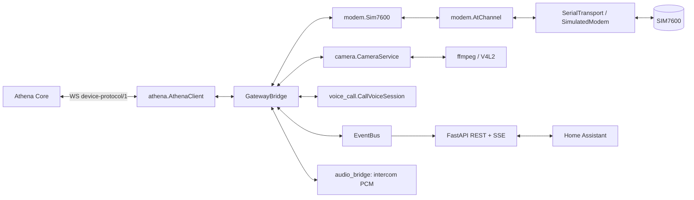
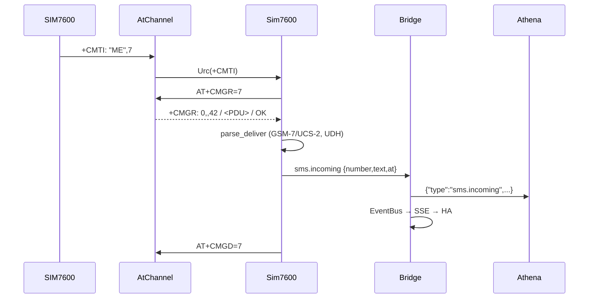
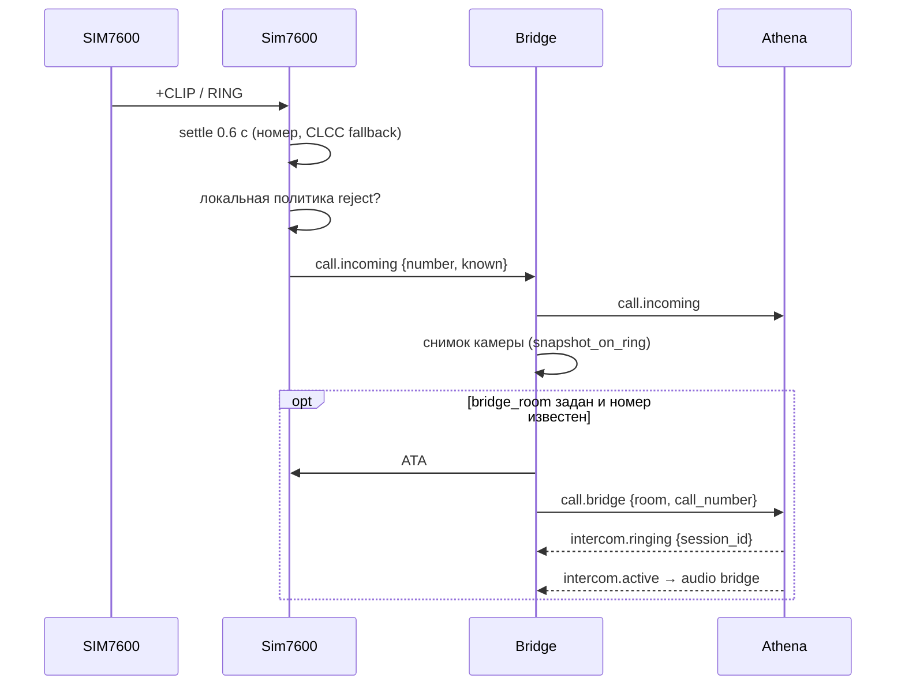
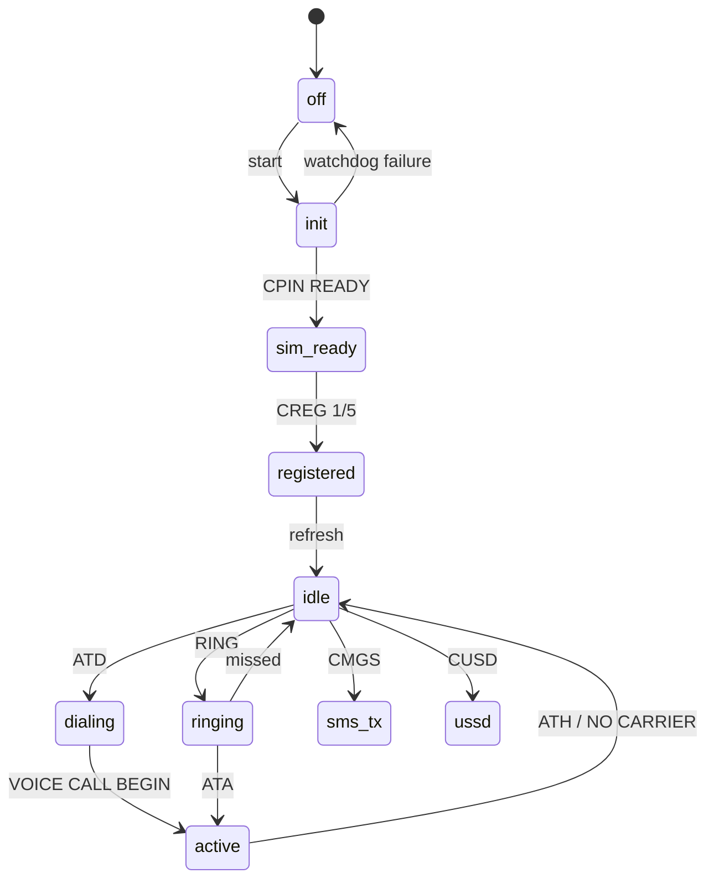

# Архитектура

Шлюз — один asyncio-процесс. Внутри шесть независимых слоёв, связанных через
`GatewayBridge`.



## Компоненты

| Модуль | Ответственность |
|---|---|
| `athena/client.py` | Сессия с ядром: hello/welcome, heartbeat, команды, ack, события, реконнект |
| `athena/frames.py` | Чистые билдеры кадров протокола |
| `modem/at_channel.py` | Строки AT, разделение ответов и URC, prompt `>`, таймауты |
| `modem/sim7600.py` | Высокоуровневые операции, состояние звонка, watchdog |
| `modem/pdu.py` | GSM 03.38/03.40: SMS-SUBMIT/DELIVER, UDH, SCTS |
| `modem/mock.py` | Полный симулятор модема для демо и тестов |
| `camera/backend.py` | ffmpeg-процесс, JPEG-парсер, запись клипов |
| `camera/service.py` | Кадры, MJPEG-подписчики, снимки, движение |
| `voice_call.py` | Голосовой диалог с абонентом: VAD, `audio.start`/PCM/`audio.end`, проигрывание `audio.url` |
| `audio_bridge.py` | arecord/aplay ↔ PCM 16 кГц для intercom (bridge mode) |
| `bridge.py` | Политики, маршрутизация команд/событий, журналы |
| `bus.py` | Внутренняя шина событий и история для SSE |
| `app.py` | REST, SSE, дашборд, авторизация |

## Потоки данных

### Входящая SMS



Дубликатов нет: сообщение удаляется из памяти модема после успешного разбора.
Если ядро недоступно, событие остаётся в локальной истории и SSE, но не
переотправляется после реконнекта (требование протокола — события не
идемпотентны).

### Входящий звонок



`call.incoming` уходит **до** `ATA`, как требует протокол. Номер нормализуется к
`+7XXXXXXXXXX`. Если номер не определился, звонок не отправляется в ядро; при
политике `reject` он отклоняется локально.

Если bridge не запрошен, после `ATA` запускается `CallVoiceSession` — голосовой
диалог с абонентом (assistant voice). При `mode="bridge"` шлюз сначала проверяет
доступность аудио (`[audio_bridge].enabled` + ALSA/mock), затем отвечает и шлёт
`call.bridge`. Если bridge не удался, а звонок ещё активен, происходит fallback на
assistant voice; если звонок уже сброшен — шлюз завершает его.

### Исходящий звонок

Команда `call {action:"dial"}` → `ATD<number>;` → `command.ack done` сразу после
принятия команды модемом. `call.state active` отправляется по URC
`VOICE CALL: BEGIN`, `ended` — по `NO CARRIER` / `VOICE CALL: END`, с длительностью
разговора.

## Состояния модема



`off`/`init` считаются offline, остальные — online. Heartbeat шлёт
`status="degraded"`, если нет регистрации в сети.

## Надёжность

- **AT watchdog**: 3 таймаута подряд → `recover()`: `AT+CFUN=1,1` (или GPIO),
  закрытие порта, повторное открытие с backoff 5–30 с.
- **WS реконнект**: 1, 2, 4, 8, 16, 30, 60 с + 0–20 % jitter. Close 4000 не
  переподключается (сессия заменена), 1008 `revoked` — пауза 10 минут.
- **Идемпотентность**: `last_command_id` хранится в
  `state/athena_state.json`; повторный id получает сохранённый ack без выполнения.
- **Очереди кадров**: SSE-подписчики имеют буфер 200; медленный клиент теряет
  старые события, но не блокирует остальных.
- **Камера**: ffmpeg перезапускается с backoff; отсутствие кадра не влияет на
  телефонию. Снимок при звонке делается в фоне (`create_task`).

## Потоки и блокировки

- Один `asyncio.Lock` в `AtChannel` сериализует AT-команды; URC обрабатываются
  отдельной очередью, поэтому `RING` не теряется во время `AT+CSQ`.
- `AudioBridge` использует отдельный lock на запись в `aplay`.
- `CallVoiceSession` сериализует захват/воспроизведение ALSA и глушит микрофон на
  время проигрывания ответа, чтобы не поймать эхо.
- `AthenaClient` сериализует отправку кадров одним `_send_lock`, чтобы
  heartbeat/ack/события не перемешивались на уровне websocket.

## Локальное состояние

```
data/                    # state_dir
├── athena_state.json    # last_command_id
├── snapshots/*.jpg      # снимки (ring/api)
└── clips/*.mp4          # видеоклипы
```

Файлы не содержат номеров и текстов; только кадры и технический id команд.

## Границы безопасности

- Ядро доверяет GSM-endpoint (v1): политика звонков и SMS-команд — локальная.
- Локальный API — отдельный доверенный контур (HA). Bearer-токен обязателен,
  кроме `allow_anonymous_camera`.
- В логи маскируются номера и не пишутся PDU/тексты SMS. AT-журнал (50 строк)
  доступен только через `/api/diagnostics` с токеном.
